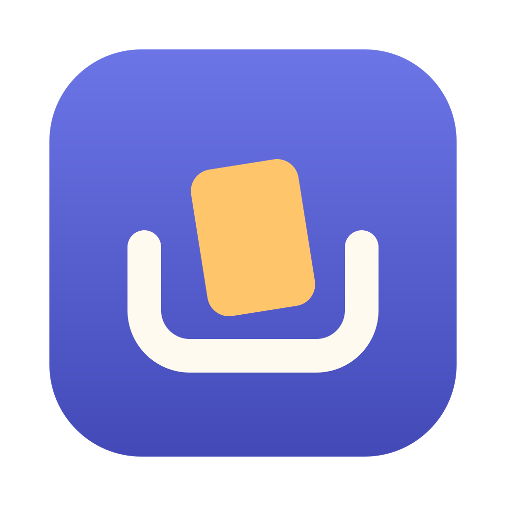

<p align="center">
  
</p>

<p align="center">
  
  
  
  
</p>

**Stashd** is a menu bar app for your Mac. Press **⇧⌘S** and it stashes the work you're in the middle of: your open tabs, documents and apps, plus a quick note. When you come back, pick the job from the menu bar. A short brief tells you where you left off, and one click reopens what you need.

Everything stays on your Mac. The only time it goes online is to write Claude briefs, and only after you connect your own Claude key.

> [!NOTE]
> **Coming from Where Was I?** Stashd is its new name. On first launch, Stashd copies your jobs, settings and what it has learned from the old app, and leaves the old copy untouched. Two things to redo once: reconnect Claude in Settings, and click **OK** again when macOS asks to let Stashd control your apps. After that you can delete *Where Was I* from Applications.

---

## How it works

| | |
|---|---|
| **1 · Stash** | Press **⇧⌘S**. Stashd sees what's open and ticks what belongs to this job. Add a note for the robot 🤖 if you like, then press **Enter**. |
| **2 · Tidy (optional)** | Turn on **Tidy up after saving** and your windows fly into the menu bar icon. **Undo** brings them back for 10 seconds. |
| **3 · Pick up** | Click the menu bar icon or press **⇧⌘W**, then choose a job. Read the brief, then hit **Pick up where I left off**. |

## Install

1. Open **Stashd.dmg** (after `npm run make` it's in `out/make/`) and drag **Stashd** into **Applications**. If it asks, click **Replace** to update an older version.
2. **First launch only:** in Applications, **right-click** Stashd, choose **Open**, then click **Open** again.
   The app isn't signed with a paid Apple developer certificate, so a normal double-click is blocked the first time. If macOS still refuses, go to **System Settings → Privacy & Security** and click **Open Anyway**.
3. The Stashd mark appears in your menu bar. There's no Dock icon, on purpose.

> [!TIP]
> The first time you stash with Chrome, Safari, Word and so on open, macOS asks for permission to control that app (once per app). Click **OK**. That's how Stashd reads tab addresses and which files are open. If you clicked "Don't Allow", the save box shows a button that opens the right System Settings page.

## Everyday use

| You want to… | Do this |
|---|---|
| Stash what you're working on | **⇧⌘S**, optional note, **Enter** |
| Clear your screen too | Tick **Tidy up after saving** |
| See where you were | Click the menu bar icon, or **⇧⌘W** |
| Get back to work | **Pick up where I left off** (just what you need) or **All** |
| Fix what's in a job | **All jobs**: remove items with ✕, or drag them onto another job |
| Rename, finish or delete a job | In the job's brief, click **…** |

**It learns as you go.** Everyday apps and sites (Spotify, Messages, Gmail…) are never part of a job and are never closed. If you keep leaving something out, it stops suggesting it. If you keep adding something, it starts ticking it for you.

## Briefs

Each brief is written by the first of these that's available:

1. **Claude**, if you connected it (Settings → Claude). Costs about $0.0003 per brief. It gets file names, tab titles and addresses with secrets removed, plus your note. It never sees what's inside your files.
2. **Apple Intelligence** on your Mac, if it's turned on. Free and offline.
3. A **basic brief** from a template, so there's always something.

The bottom of each brief says which one wrote it. Click **No** under "Helpful?" to say what was wrong, and the next brief for that job takes it into account.

## Privacy

- Jobs live on disk in `~/Library/Application Support/Stashd/jobs/`.
- Your Claude key is stored encrypted in the macOS keychain.
- `tests/privacy.test.ts` fails the build if anything except `src/main/brief/claude.ts` tries to use the internet.

---

## Development

Requires Node.js and Xcode command line tools (for the small Swift helper).

```bash
npm install
npm start
```

| Command | What it does |
|---|---|
| `npm start` | Runs a dev copy (builds the Swift helper and embedder first) |
| `npm test` | Runs the test suite |
| `npm run typecheck` | Type-checks the code |
| `npm run lint` | Lints and checks formatting |
| `npm run make` | Builds a DMG and zip into `out/make` |
| `npm run icons` | Redraws the app and menu bar icons from `scripts/make-icons.mjs` |

### Project map

```
src/main/capture/      what's open: apps and window order (helper), documents (AppleScript), tabs (collectors/browsers.ts)
src/main/jobs/         what belongs to which job (match.ts, relevance.ts) and learning from corrections
src/main/meaning/      on-device meaning model for job sorting
src/main/brief/        the three brief writers, and exactly what is sent (prompt.ts)
src/main/tidy*.ts      closing safely, naming untitled files, the fly-in animation and Undo
src/main/store.ts      jobs on disk
src/main/legacy.ts     one-time move of data from the old Where Was I folder
src/renderer/          the screens: Panel, Save, Tidy, Main, SettingsView
native/wwi-helper.swift  window order, app icons, Apple Intelligence
```

`PLAN.md` is the product plan. `design/` has the mockups, the build prompt and the brand page.

### Dev-only switches

The installed app ignores these.

| Variable | Effect |
|---|---|
| `WWI_USER_DATA=<folder>` | Separate data folder, so a dev copy can run next to the installed app |
| `WWI_FAKE_CAPTURE=<file.json>` | Fake "what's open", so tests never touch your real apps |
| `WWI_CAPTURE_DIR=<folder>` | Saves a picture of each window |
| `WWI_DEMO_TIDY=1` | Shows the tidy-up screens with demo data |

## Brand



A geometric **S** made of two stacked, offset blocks: two pieces of work, put away neatly. Black and white only, so it holds up at 16px in the menu bar.

- `assets/brand/stashd-icon.svg`: the app icon (vector)
- `assets/brand/stashd-mark.svg`: the bare mark, black in light mode and white in dark mode
- `assets/brand/stashd-hero.svg`: the animated banner above
- `design/brand.html`: the icon brought to life with [Motion](https://motion.dev) springs. Open it in a browser and click the icon.
- `scripts/make-icons.mjs`: draws the same mark into `icon.icns` and the menu bar template

Colours: graphite `#26262C → #0C0C0F` tile, white `#FFFFFF` mark, ink `#0A0A0C` backgrounds.

## License

MIT (see `package.json`)
